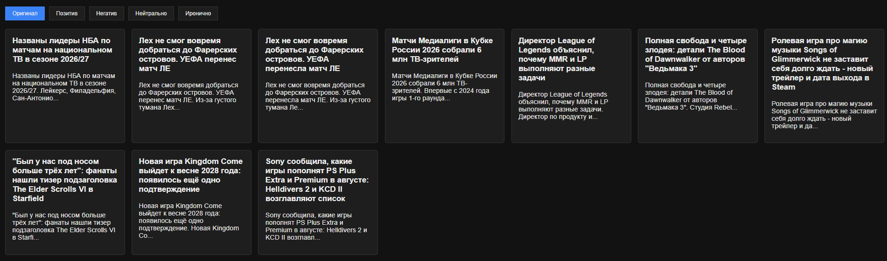
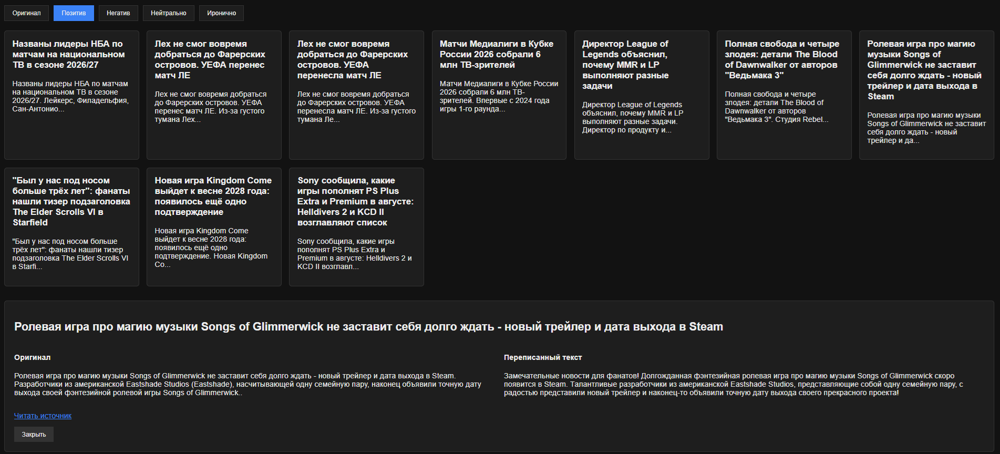
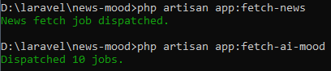
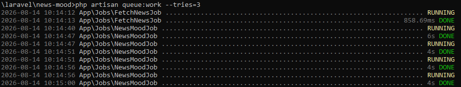

# News Mood — новости в разных эмоциональных тонах

Приложение берёт реальные новости об играх/видеоиграх из открытого источника,
переписывает их в четырёх эмоциональных стилях (позитив, негатив, нейтрально,
иронично) с помощью ИИ и показывает рядом с оригиналом, сохраняя факты
неизменными.

## Скриншоты


*Общий вид главной страницы с новостями*


*Выбрано настроение, открыта карточка новости — оригинал и переписанный текст рядом*


*Запуск `php artisan app:fetch-news` и `php artisan app:fetch-ai-mood`*


*Вывод `php artisan queue:work` — обработка джобов*

## Стек

- PHP 8.x, Laravel 11
- MySQL
- Laravel Queue (driver: database) — для очередей парсинга и AI-обработки
- Blade + Vite (обычный JS/CSS, без фреймворков на фронте)
- GNews API — источник новостей
- Gemini (через собственный API-прокси) — рерайт тона

## Как запустить

```bash
git clone 
cd folder

composer install (если надо)
npm install (для работы @vite)

cp .env.example .env
php artisan key:generate
```

Прописать в `.env`:

```
DB_DATABASE=...
DB_USERNAME=...
DB_PASSWORD=...

QUEUE_CONNECTION=database
```

```bash
php artisan migrate
```

### Получение API-токенов

Для работы приложения нужны два ключа — без них парсинг новостей и рерайт
тона работать не будут.

1. **GNews** — источник новостей. Зарегистрироваться и получить бесплатный
   ключ: https://gnews.io/ (личный кабинет → API Key).
2. **Gemini (Google AI)** — рерайт тона. Получить ключ можно в
   [Google AI Studio](https://aistudio.google.com/apikey), либо использовать
   любой другой совместимый сервис (например, GLM от Z.ai — если используете
   его, поменяйте `apiUrl` и модель в `AiNewsService`).

После получения ключей заменить `'YOUR_TOKEN_HERE'` на реальные значения:

- `app/Services/NewsService.php` → константа `API_KEY` (ключ GNews)
- `app/Services/AiNewsService.php` → константа `API_KEY` (ключ Gemini)

```bash
npm run dev
```

Запуск пайплайна (в отдельных терминалах, либо через supervisor):

```bash
# 1. Сам сайт
php artisan serve --port=8000

# 2. Обработчик очереди — должен работать постоянно
php artisan queue:work --tries=3

# 3. Собрать новости из GNews (можно запускать по крону раз в N часов)
php artisan app:fetch-news

# 4. Переписать собранные новости в разных тонах (после того как новости появились в БД)
php artisan app:fetch-ai-mood
```

Страница со списком новостей: `http://localhost:8000/`

## Откуда берутся новости

Источник — [GNews API](https://gnews.io), поиск по ключевым словам
(`игры`, `gaming`, `videogames`, `видеоигры`), язык — русский,
до 10 новостей за один запрос, сортировка по дате публикации.

Реализовано в `app/Services/NewsService.php`:
- запрос к GNews через `HttpReqService` (обёртка над cURL);
- нормализация ответа (`jsonNewsNormalizer`) — из ответа API берутся только
  нужные поля: `id`, `title`, `content`/`description`, `url`, `publishedAt`;
- каждой новости сразу проставляется `status = no_mod` (ещё не обработана ИИ).

Запуск и сохранение в БД вынесены в очередь: команда `app:fetch-news`
(`app/Console/Commands/FetchNews.php`) только диспатчит `FetchNewsJob`
(`app/Jobs/FetchNewsJob.php`), сам HTTP-запрос и запись в БД происходят
в Job'е — это защищает команду от таймаутов и даёт автоматические
повторные попытки при сбое API.

## Как устроено хранение данных

Две основные таблицы:

**`news`** — сырые новости из источника:
| поле | назначение |
|---|---|
| `api_id` | id новости в GNews, для дедупликации через `firstOrCreate` |
| `title`, `text` | заголовок и исходный текст |
| `source` | ссылка на оригинал |
| `status` | `no_mod` — ещё не обработана ИИ / `mod` — обработана |
| `facts` | оригинальные факты новости (`original_facts` от ИИ), заполняется при обработке |
| `published_at` | дата публикации |

**`news_moods`** — переписанные версии, `hasMany` от `News`:
| поле | назначение |
|---|---|
| `news_id` | внешний ключ на новость |
| `mood` | `positive` / `negative` / `neutral` / `ironic` |
| `text` | переписанный текст |
| `facts` | факты, которые ИИ выделил именно для этой версии (JSON) |

Дедупликация новостей — на уровне `api_id` через `firstOrCreate`, поэтому
повторный запуск `app:fetch-news` не создаёт дублей.

## Как переписывается тон

Команда `app:fetch-ai-mood` (`app/Console/Commands/FetchAiMood.php`)
выбирает все новости со статусом `no_mod` и запускает по одному
`NewsMoodJob` на каждую новость.

Каждый Job (`app/Jobs/NewsMoodJob.php`) обращается к `AiNewsService`,
который отправляет текст новости в ИИ (Gemini) с промптом, требующим:
- сначала выделить факты исходной новости (`original_facts`);
- затем создать 4 версии текста (positive / negative / neutral / ironic),
  каждая — с собственным списком фактов, которые эта версия содержит;
- явный запрет добавлять новые факты, даты, числа, имена, места, цитаты —
  разрешено менять только стиль и тон подачи.

После успешной проверки фактов Job сохраняет `original_facts`
в колонку `facts` таблицы `news` (сама новость) и по одной записи в
`news_moods` на каждую из 4 версий текста, затем переводит новость в
статус `mod`.

Ограничение скорости запросов к ИИ (15 в минуту) реализовано через
Laravel Queue rate limiting (`RateLimiter::for('ai-mood', ...)` в
`AppServiceProvider` + `RateLimited` middleware на Job'е) — это работает
независимо от того, сколько новостей обрабатывается за раз (10 или 1000),
и не требует ручного ограничения выборки.

## Как проверяется сохранение фактов

Реализованы два независимых контура проверки — автоматический и ручной.

**Автоматический.** После получения ответа от ИИ (`AiNewsService::checkReqResult`)
факты из `original_facts` сравниваются с фактами каждой эмоциональной версии
не побуквенно (LLM физически не повторяет текст дословно даже при точной
инструкции), а через нормализацию + `similar_text()`:
1. Оба набора фактов приводятся к нижнему регистру, из них убирается пунктуация.
2. Считается процент схожести между склеенными наборами.
3. Если схожесть ниже 50% — версия считается ненадёжной, новость **не**
   сохраняется в `news_moods`, статус новости остаётся `no_mod`, ошибка
   пишется в `storage/logs/ai-mood.log`.

**Ручной.** Для каждой успешно прошедшей проверку новости в
`storage/logs/facts-check.log` пишется отдельная запись: время, id новости,
`original_facts` и facts каждой из 4 эмоций рядом — чтобы можно было
физически открыть лог и глазами сверить, что факты в переписанных версиях
соответствуют оригиналу.

## Что использовали из AI

- Модель: Gemini (`gemini-3.5-flash-lite`) — для рерайта тона новостей и
  выделения фактов.
- Промпт-инжиниринг: жёсткий формат ответа (строгий JSON), явные запреты на
  добавление фактов/предположений, отдельное поле фактов на каждую версию
  текста для последующей автоматической сверки.
- Ассистент (Claude) использовался для ревью и рефакторинга кода: поиска
  багов в парсинге ответа ИИ, проектирования очередей с rate limiting и
  логики мягкого сравнения фактов.

## Известные ограничения

- GNews бесплатный тариф ограничен по количеству запросов в день — при
  превышении лимита `app:fetch-news` вернёт ошибку, которая пишется в лог.
- Порог схожести фактов (50%) подобран эмпирически, может потребовать
  калибровки на большем объёме новостей.
